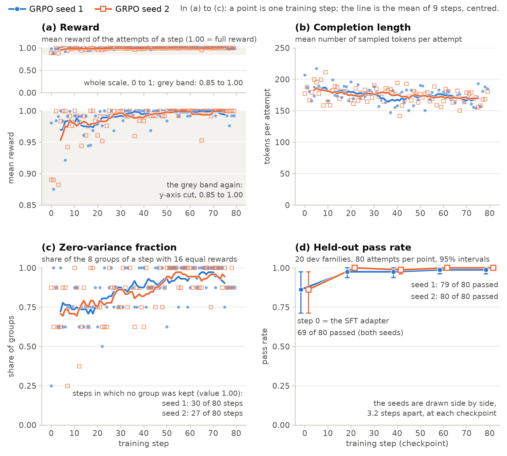

# A small GRPO run on a tiny model

Sri. README.md maps each number to its file.

## 1. The question and the approach

Does SFT, then GRPO, work at toy scale: is the reward wired correctly, does training improve held-out behaviour, does the model exploit the reward?

SFT (rejection sampling) trains the base model on 452 of its own passes (reward 100, no refused call). GRPO trains the SFT adapter for 80 steps, two seeds: 8 scenarios x 16 attempts per step, advantage = reward minus group mean, equal-reward groups dropped, no KL term. Both losses count only tokens the model wrote; prompt and tool results are masked. Scenarios, splits, grader, evaluation and the analysis plan were frozen before every reported run; trial steps and five calibration rounds came first, audit and report code were hashed later (NOTES.md 5 and 6). The loop is our own (transformers, peft), checked against TRL's advantages. One model both samples and trains, and the code is small enough to explain line by line.

## 2. Setup

| Item | What was used |
|---|---|
| Environment | In-memory, deterministic desk; 5 tools (the five of the brief's example); at most 8 turns; the system prompt gives the rules step by step. First rule wins: inactive: deny; role held: already; sensitive: manager's approval; else grant. Half the families: two people, one name. |
| Scenarios | Scenario = one family (one world, one right end state) in one wording style. Train: 200 families, 600 scenarios (styles 1 to 3). Dev, test: 48 families, 192 scenarios each (4 styles; style 4 is not in train); 8 attempts each. |
| Reward | Final state only; no LLM judge. Fail 0. Pass 100, minus 5 per malformed message (at most 15), minus 2 per turn over the budget (at most 10; budget: shortest correct path plus one). Within 8 turns a pass scores 77 or more. |
| Model | Qwen/Qwen3.5-2B (pinned revision), thinking off, temperature 1.0. Base: this model with no adapter. |
| LoRA targets and why | Rank 16, alpha 32, 15,630,336 trainable weights: q/k/v/o_proj (6 full-attention layers); in_proj_qkv, in_proj_z, out_proj (18 linear-attention layers); MLP gate/up/down_proj (24). Why: to cover both layer types; PEFT has no default for this model, and its Qwen3 list (q_proj, v_proj) adapts no linear-attention layer. No narrower set was tested. Left out by judgement, untested: in_proj_a, in_proj_b (small gate projections); lm_head, embed_tokens (one shared tensor outside the decoder layers). Check: 150 of 187 linear modules, all 24 layers, no zero update. |

## 3. Results

| Arm | Dev pass % [CI] | Dev difference | Test pass % [CI] | Test difference | All 8 equal, % | Malformed, % |
|---|---|---|---|---|---|---|
| base | 39.8 [31.4, 48.4] | | 41.3 [32.2, 50.1] | | 26.6 / 26.6 | 4.6 / 4.1 |
| sft | 89.4 [82.1, 95.4] | +49.6 [+41.1, +57.9] | 91.3 [85.9, 95.8] | +50.1 [+42.2, +58.1] | 71.9 / 66.1 | 0.7 / 1.1 |
| grpo_seed1 | 98.6 [96.5, 99.9] | +9.2 [+3.1, +16.7] | 99.5 [99.0, 99.9] | +8.2 [+3.9, +13.6] | 94.8 / 95.8 | 0.1 / 0.1 |
| grpo_seed2 | 97.7 [93.8, 99.9] | +8.3 [+1.5, +16.1] | 99.5 [99.0, 99.9] | +8.1 [+3.7, +13.5] | 95.3 / 93.8 | 0.2 / 0.1 |

Last two columns: dev / test. All 8 equal: scenarios whose 8 rewards are equal. Malformed (the invalid-call rate): assistant messages that are not one valid tool call; calls that a tool refuses are not in it. Base, dev rewards: 925 attempts at 0, 553 at 100, 58 from 79 to 98. Differences: sft minus base, GRPO minus sft. 95% intervals, families resampled; differences paired by family. Test is primary: dev was watched, test ran once.

## 4. What the run shows

- **Reward wired correctly: yes, as far as the checks reach.** A second verifier grades a replay of 45,696 attempts with 0 differences and catches three verifiers broken on purpose. A fault in the one rules file that both read would not show; six end states that Sri wrote by hand match it (6 of 6; at first one could not be read). Advantages rebuilt from 20,480 saved GRPO rewards fit the training log (counts exact; loss check weak); the trainer's use of them rests on GPU tests on hand-made batches.
- **Held-out behaviour improves: yes.** Test: SFT +50.1, GRPO +8.2 and +8.1, all intervals above zero; inactive-person scenarios, weakest after SFT (72.7%), give 105 of the 126 and 125 added passes.
- **Exploit: none found.** A pass needs the whole final state to equal the expected one, no extra record, so a wrong, needless or repeated write fails; monitors watch the path. Known hole: a refused call writes nothing and costs no points (NOTES.md section 3, refused call). m1 to m3 (refused call, id from no tool result, access not checked) flag 1 of 3,010 top-reward GRPO dev attempts (an id missing a letter, refused, then right) and 0 of 3,049 on test; m4, m5 (repeated call, words outside a call) flag 32 and 28.

## 5. The curves

Figure 1 (pairs: seed 1, 2). Most groups had 16 equal rewards from the start (58 and 57 of 80, steps 0 to 9), so no gradient: GRPO kept 91 and 95 of 640 groups, 36 and 45 with no failed attempt (rewards differ only by penalties); 30 and 27 steps kept none. Most failed training attempts came in steps 0 to 19 (65 of 100; 77 of 121), and the dev curve rose from 69 of 80 to 78 and 80 by step 20. Later it moved by one attempt at most, with little signal left: 73 and 76 of 80 groups had equal rewards in steps 70 to 79. Tokens per attempt: 187 and 185 (steps 0 to 9), 172 and 171 (70 to 79); malformed at most 2.80% and 2.54% per step.

## 6. The audit

On a blind sheet Sri labelled 31 dev GRPO attempts by hand, 21 top-reward and 10 failed, with two labels each: "end state right" and "path acceptable". On "end state right" the sheet agrees with the verifier in 19 of 31, or 19 of 28 without the 3 labels of dev family dv-46 (section 7), which are not blind: the coding assistant had told Sri dv-46 fails. All 10 failed attempts have the label "path acceptable: no". The answer key was in the repository; Sri states that it was not opened before the labels were finished. With the key open, the assistant found the verifier right in all 12 differences. **So the hand audit is no independent check.**

## 7. What did not work

**One dev family lost more than one pass after GRPO.** dv-46 (grant; an inactive namesake is first in the lookup) passes 24 of 32 after SFT, 17 and 3 after GRPO, denying the right person in 8 and 22 attempts. Cause: not known; the four other dev families where an active person has an inactive namesake show no wrong denial. Neither test grant family with an inactive namesake (te-08, te-31) got worse; test denials of the right person are rare, not absent: 4 in 1,536 attempts of seed 2 (`results/main/report/failures/test/`).

**GRPO had little to learn from.** Most groups had equal rewards, so 30 and 27 of the 80 steps kept no group (section 5).

## 8. Stretch, cost, limits, next steps

Not run: the stretch bonus (results/stretch.md) and the plan's two planned extras (a teacher arm, a hint check). Run, not discussed here: the plan's other extra, a second desk with a changed rule (results/main/audit/second_desk/).

Rented single-GPU RTX 4090 machines (Vast.ai): 36.95 rented GPU hours and 19.44 USD by our ledger (results/spend_ledger.csv); Vast.ai charged 18.96 USD. They are not the brief's Colab, Kaggle or managed service; they were chosen because the coding assistant could drive a plain machine by script and the two seeds could run at the same time on two machines. The billing export is sent beside the repository, for repayment. Sri's own hours: about 20 (an estimate; the assistant's working time is not counted).

Limits: one environment, rule list and base model; 80 steps; two seeds are two runs, not the spread of the method. A larger run needs faster sampling: sampling took 2.34 and 2.43 GPU hours of the GRPO steps, the updates 0.13 and 0.17 (`results/main/report/training/training_report.json`, fields `runs.seed1.time`, `runs.seed2.time`). A sampler apart from the trainer gives samples from older weights; their importance ratio and clipping are not in this loop and were not tested.

**What comes next.** More grant families of the dv-46 kind, varied in list order, to find its cause; mixed-wording groups for the stretch bonus; tasks with more unequal-reward groups.

*Figure 1. Two seeds, 80 steps. Panel (d): 20 held-out dev families, in a wording style that training saw.*
