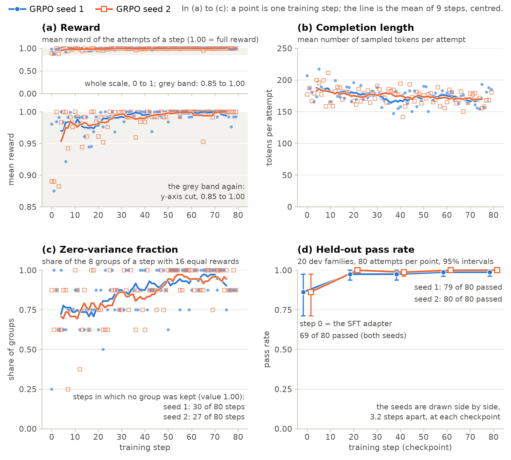

# Figure 1. Learning curves of the 2 GRPO runs

**Caption.** Learning curves of the 2 GRPO runs (seed 1 and seed 2; 80 steps each; a step is 8 training scenarios x 16 attempts = 128 attempts): for each step, (a) the mean reward (1.00 is the full reward), (b) the mean number of sampled tokens per attempt, and (c) the share of groups whose 16 rewards are exactly equal, each with a line that is the mean of 9 steps centred on its step; every y-axis starts at 0, except the lower part of (a), which shows the range 0.85 to 1.00 again and so makes small changes look larger. Panel (d) shows the pass rate of 20 dev families at the checkpoints of steps 0, 20, 40, 60 and 80, with a 95% interval from resampling the families; each point holds 80 attempts (one wording style, 4 attempts per family), and step 0 is the SFT adapter that both runs started from. The mean reward was 0.974 (seed 1) and 0.969 (seed 2) in steps 0 to 19, and 0.997 (seed 1) and 0.997 (seed 2) in steps 60 to 79; the trainer kept no group in 30 of the 80 steps of seed 1 and in 27 of the 80 steps of seed 2. On the 20 dev families, 69 of 80 attempts passed at step 0 (both seeds), and 79 of 80 (seed 1) and 80 of 80 (seed 2) at step 80.

## Words

- GRPO: the training method of these runs. In each group it makes the attempts with a reward above the mean of the group more likely, and the attempts below it less likely.
- Attempt: one conversation of the model with the tools of the access desk. It passes or fails, and it gets a reward.
- Family and scenario: a family is one world with one correct end state. A scenario is one family in one wording style.
- Group: the 16 attempts of one scenario in one step.
- Step: the model makes 128 attempts with the weights that it has. Then the trainer computes one change of the weights from the groups that it keeps.
- Seed: the number that fixes the order of the scenarios and the sampling of a run. Each seed is one training run.
- Adapter and checkpoint: the adapter is the small set of trained weights (LoRA). A checkpoint is the adapter as it was saved after a number of steps.
- SFT: the stage before GRPO. It trains the adapter on attempts of the untrained model that passed (`ANALYSIS_PLAN.md`, section 7).
- Sampled token: a token that the model wrote. Prompts and tool results are not sampled.
- Malformed message: an assistant message that is not exactly one valid tool call.
- Harness: the program that runs the attempts. An attempt that it loses is in no number.
- Dev family: a family of the dev split. The GRPO runs trained on the train split (run manifests).
- Family-weighted pass rate: the pass rate of each family first, then the mean over the families.

## Notes to the caption: what each panel counts

The x-axis is the training step. A point at step s in (a) to (c) shows attempts that the model made after s earlier steps (the steps 0 to s - 1). A checkpoint of step s holds the weights after s steps. So a point of (a) to (c) and a checkpoint at the same x have the same weights.

Every y-axis starts at 0: (a), (c) and (d) go from 0 to 1, and (b) goes from 0 to 250 tokens. The one exception is the lower part of (a): it shows the range 0.85 to 1.00 of the upper part again.

- **(a) Reward.** The mean reward of the 128 attempts of a step, divided by 100, so 1.00 is the full reward. Source: the field `mean_reward` of `train_log.jsonl`. Rule: the rewards of the valid attempts of the step, divided by 100, then their mean. Unit: reward / 100. Count: 128 attempts per point. The harness lost 0 of the 20,480 attempts of the 160 steps.
  An attempt that fails has the reward 0. An attempt that passes has 100, minus 5 for each malformed message (at most 15), minus 2 for each turn over the budget (at most 10). These numbers are in the run manifests (`config`). The budget is the shortest correct path plus one turn (`ANALYSIS_PLAN.md`, section 6).
  One attempt that fails in place of a full reward lowers the mean of a step by 1/128 = 0.008.
  y-axis: the upper part shows the whole scale, from 0 to 1. The lower part shows the same values again with a cut y-axis, from 0.85 to 1.00. The cut makes a change look larger than it is on the whole scale.
- **(b) Completion length.** The mean number of sampled tokens per attempt. Source: the field `tokens_per_episode` (`rollout_stats` in `accessdesk/train/grpo.py`). Rule: the sampled tokens of all assistant messages of the valid attempts of the step, divided by the number of valid attempts. Unit: tokens per attempt. Count: 128 attempts per point.
  A message counts with its end-of-turn token. A malformed message counts too. A message that the token cap (260 tokens per message, run manifests) cut off counts with the tokens up to the cap.
  An attempt has 3.53 (seed 1) and 3.51 (seed 2) assistant messages on average (the field `turns_per_episode`, over all steps). The length of an attempt is the sum of the lengths of its messages.
  y-axis: from 0 to 250 tokens.
- **(c) Zero-variance fraction.** The share of the 8 groups of a step whose 16 rewards are exactly equal. Source: the field `zero_variance_exact` (`metrics.zero_variance_share`, `equal_reward`). Rule: the number of groups whose valid attempts all have exactly the same reward, divided by the number of groups. Count: 8 groups of 16 attempts per point. A value of the line is a share of 72 groups.
  This is the rule of the trainer: it drops a group whose rewards are all equal. Its tie tolerance is 0, so only exactly equal rewards count as equal. A dropped group adds nothing to the change of the weights.
  Over all steps the trainer kept 91 of the 640 groups of seed 1 and 95 of the 640 groups of seed 2 (the field `kept_groups`).
  In every step the kept groups are exactly the groups whose rewards are not all equal.
  The trainer kept no group in 30 of the 80 steps of seed 1 and 27 of the 80 steps of seed 2. In each of these steps the log has a loss of 0 and a gradient norm of 0: the step gave the trainer nothing to learn from. These are the steps with the value 1.00 in the panel.
  y-axis: the whole scale, from 0 to 1.
- **(d) Held-out pass rate.** The family-weighted pass rate of 20 dev families at the checkpoints of steps 0, 20, 40, 60 and 80, with a 95% interval from resampling the 20 families. Each point holds 80 attempts: 20 families in one wording style, 4 attempts per family. Source: `episodes.jsonl` of each point of the dev curve. Rule: the pass rate of each family over its attempts, then the mean over the families (`metrics.pass_rate`). Unit: the family. Count: 80 attempts per point: the 20 dev families of the set `curve_subset` in wording style 1, 4 attempts per scenario, sampled with the run seed 0 (run manifests). The harness lost 0 of the 800 attempts of the 10 points.
  Held out means: no GRPO step used a dev family. The runs trained on the train split, in the wording styles 1, 2 and 3 (run manifests). The wording style of the curve is one of them. So the curve tests new families, not a new wording style.
  Interval: 95%, from 10,000 draws. Each draw takes 20 families with replacement from the 20, and their mean pass rate (`metrics.family_bootstrap_ci`, seed 0, the percentile form). In 3 of the 10 points every attempt passed. The interval then has no width: this method cannot show the doubt that is left.
  The points of step 0 used the adapter `results/main/sft/adapter` (`adapter` in the run manifest of each point). This is the adapter that each GRPO run started from (`start_adapter` in the run manifest of the GRPO run): the SFT adapter, trained by `scripts/gpu/train_sft.py`. The SHA-256 of `adapter_model.safetensors` is the same in `chain_record.txt` of the point and in the manifest of the GRPO run. So the points of step 0 are 2 rollouts of one model with one run seed. Attempts that passed: 69 of 80 (seed 1) and 69 of 80 (seed 2).
  The points of the steps 20, 40, 60 and 80 used the checkpoint that the run saved after that number of steps (`checkpoints/step_<step>/adapter`, run manifests).
  The labels in the panel give the attempts that passed at the first and at the last checkpoint. The table below has all points.
  The points of the seeds are drawn 3.2 steps apart, to the left and to the right of the checkpoint step, so that every interval can be seen.
  y-axis: the whole scale, from 0 to 1.

The line of (a) to (c): for step s, the mean of the values of the steps s - 4 to s + 4 (9 steps). It is drawn only where all these steps exist: from step 4 to step 75.

## The numbers by block of 20 steps

From `train_log.jsonl` of each run. Mean reward and tokens per attempt: over all valid attempts of the block. Groups with equal rewards: their number in the block, and the mean of the zero-variance fractions of its steps.

| Seed | Steps | Attempts | Mean reward | Tokens per attempt | Groups with equal rewards | Kept groups | Steps with no kept group |
|---|---|---|---|---|---|---|---|
| 1 | 0 to 19 | 2,560 | 0.974 | 183.3 | 118 of 160, 73.8% | 42 of 160 | 2 of 20 |
| 1 | 20 to 39 | 2,560 | 0.993 | 173.6 | 135 of 160, 84.4% | 25 of 160 | 6 of 20 |
| 1 | 40 to 59 | 2,560 | 0.996 | 172.5 | 146 of 160, 91.2% | 14 of 160 | 11 of 20 |
| 1 | 60 to 79 | 2,560 | 0.997 | 172.0 | 150 of 160, 93.8% | 10 of 160 | 11 of 20 |
| 2 | 0 to 19 | 2,560 | 0.969 | 181.3 | 120 of 160, 75.0% | 40 of 160 | 3 of 20 |
| 2 | 20 to 39 | 2,560 | 0.988 | 176.2 | 129 of 160, 80.6% | 31 of 160 | 3 of 20 |
| 2 | 40 to 59 | 2,560 | 0.997 | 171.8 | 146 of 160, 91.2% | 14 of 160 | 10 of 20 |
| 2 | 60 to 79 | 2,560 | 0.997 | 170.5 | 150 of 160, 93.8% | 10 of 160 | 11 of 20 |

The dev curve, from `episodes.jsonl` of each point (20 families, 80 attempts per point):

| Seed | Checkpoint step | Attempts passed | Pass rate | 95% interval | Adapter |
|---|---|---|---|---|---|
| 1 | 0 | 69 of 80 | 86.2% | 71.2% to 97.5% | `results/main/sft/adapter` |
| 1 | 20 | 78 of 80 | 97.5% | 93.8% to 100.0% | `results/main/grpo_seed1/checkpoints/step_00020/adapter` |
| 1 | 40 | 78 of 80 | 97.5% | 93.8% to 100.0% | `results/main/grpo_seed1/checkpoints/step_00040/adapter` |
| 1 | 60 | 79 of 80 | 98.8% | 96.2% to 100.0% | `results/main/grpo_seed1/checkpoints/step_00060/adapter` |
| 1 | 80 | 79 of 80 | 98.8% | 96.2% to 100.0% | `results/main/grpo_seed1/checkpoints/step_00080/adapter` |
| 2 | 0 | 69 of 80 | 86.2% | 71.2% to 97.5% | `results/main/sft/adapter` |
| 2 | 20 | 80 of 80 | 100.0% | 100.0% to 100.0% | `results/main/grpo_seed2/checkpoints/step_00020/adapter` |
| 2 | 40 | 79 of 80 | 98.8% | 96.2% to 100.0% | `results/main/grpo_seed2/checkpoints/step_00040/adapter` |
| 2 | 60 | 80 of 80 | 100.0% | 100.0% to 100.0% | `results/main/grpo_seed2/checkpoints/step_00060/adapter` |
| 2 | 80 | 80 of 80 | 100.0% | 100.0% to 100.0% | `results/main/grpo_seed2/checkpoints/step_00080/adapter` |

## What the figure cannot show

- The figure shows 2 training runs. Two runs describe two checkpoints. This does not measure how much the result changes from run to run.
- A step holds 8 scenarios, and the scenarios change from step to step: the 80 steps of seed 1 used 600 different scenarios and the 80 steps of seed 2 used 600 different scenarios (the field `scenarios` of the log). So a part of the change from one point to the next comes from the scenarios, not from the training.
- Panels (a) to (c) are made from training scenarios. Only panel (d) is made from families that the GRPO runs did not train on.
- Panel (d) is a small sample: 80 attempts per point. The pass rates of the whole dev set are in `results/main/tables/`. By the plan, no checkpoint is chosen by this curve: the result of a run is its last checkpoint (`ANALYSIS_PLAN.md`, sections 7 and 10).

## Source files

- Seed 1: `results/main/grpo_seed1/train_log.jsonl`, 80 lines, SHA-256 `b6a080196a1d7c9d...` (the run manifest names this hash). Status of the run in its manifest: complete.
- Seed 2: `results/main/grpo_seed2/train_log.jsonl`, 80 lines, SHA-256 `0c02ece824fc47c7...` (the run manifest names this hash). Status of the run in its manifest: complete.
- The dev curve: the folders `results/main/grpo_seed1_curve_<step>` and `results/main/grpo_seed2_curve_<step>` (`run_manifest.json` and `episodes.jsonl`), and the list `curve_subset` of `data/scenarios/sets.json`.
- Check of the log: for every step, the function that wrote the log line (`rollout_stats`) and the function that chooses the kept groups (`plan_update`) were run again on the saved attempts (`rollouts/step_<step>.episodes.jsonl`). They gave the logged values of `n_episodes`, `n_harness_errors`, `mean_reward`, `tokens_per_episode`, `turns_per_episode`, `zero_variance_exact`, `invalid_call_rate` and `kept_groups` in all 160 steps (20,480 attempts).
- Made by `scripts/make_figure.py` with a window of 9 steps, 10,000 bootstrap draws and the bootstrap seed 0. It reads no test result.

## Columns of `learning_curves.csv`

One row per run and step. A cell is empty where a step has no such value.

- `run`, `seed`, `step`: the run folder, its GRPO seed, and the step.
- `attempts`, `valid_attempts`: the attempts of the step, and those that the harness did not lose.
- `mean_reward`, `tokens_per_attempt`, `zero_variance_fraction`: the points of (a), (b) and (c). The same names with `_ma9` at the end: the lines.
- `groups`, `kept_groups`: the groups of the step, and the groups that the trainer kept.
- `dev_pass_rate`, `dev_ci_low`, `dev_ci_high`: the points and the intervals of (d). `dev_attempts`, `dev_valid_attempts`, `dev_passed`, `dev_families`: their counts. `dev_adapter`: the adapter of the point.

`invalid_call_rate.csv` holds the invalid-call rate of every step: the malformed assistant messages divided by all assistant messages of the step (the field `invalid_call_rate`), with both counts. It is not a panel.
